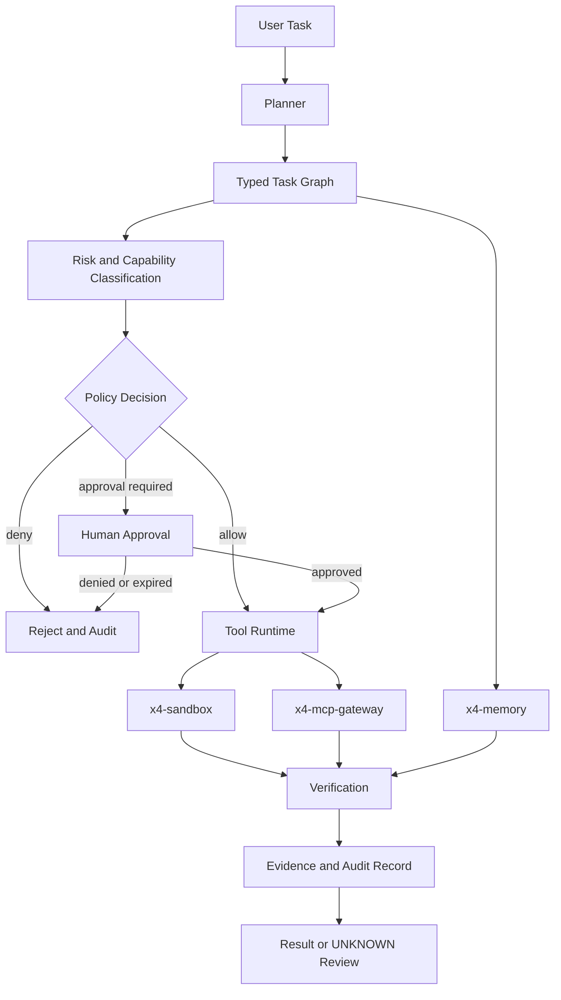
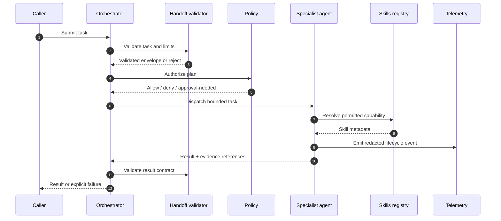

# x4-agents

**Secure multi-agent orchestration runtime**

Task graphs • Policy engine • Approvals • Sandboxed tools • Audit • Memory • MCP

[](LICENSE)
[](CHANGELOG.md)

**Flagship project of [ARIEX4Ops / X4](https://github.com/dhe-cruzer69).**

Built on security and approval concepts first explored in [ariexus](https://github.com/dhe-cruzer69/ariexus).

---

## One-line pitch

The open-source agent runtime that treats security, policy, and audit as non-negotiable production requirements.

## Why it exists

Most agent frameworks optimize for demos. x4-agents optimizes for systems that can be trusted in real environments:

- Explicit policy and risk classification before any tool runs
- Human approval gates for high-risk actions
- Immutable audit trails
- Sandboxed execution by default
- No unrestricted production credentials for agents

## High-level architecture

```
USER TASK
    │
    ▼
 PLANNER → TASK GRAPH
    ├─ Research Agent
    ├─ Coding Agent
    └─ Browser Agent
    │
 POLICY ENGINE → RISK CLASSIFICATION
    ├─ ALLOW
    └─ APPROVAL REQUIRED
    │
 TOOL RUNTIME (x4-sandbox + x4-mcp-gateway)
    │
 MEMORY (x4-memory) → VERIFICATION → RESULT → AUDIT
```

Full details in [ARCHITECTURE.md](ARCHITECTURE.md).

<!-- X4-APEX-DIAGRAM-START:x4-agents -->



<!-- X4-APEX-DIAGRAM-END:x4-agents -->

## Security model (non-negotiable)

```
Agent Intent
    ↓
Policy Engine
    ↓
Risk Score (LOW / MEDIUM / HIGH)
    ↓
Permission Check
    ↓
Human Approval (if required)
    ↓
Sandbox Execution
    ↓
Immutable Audit Event
```

## Related projects

| Project | Role |
|---------|------|
| [x4-core](https://github.com/dhe-cruzer69/x4-core) | Shared foundation |
| [x4-ai](https://github.com/dhe-cruzer69/x4-ai) | Provider-agnostic models |
| [x4-memory](https://github.com/dhe-cruzer69/x4-memory) | Persistent memory |
| [x4-sandbox](https://github.com/dhe-cruzer69/x4-sandbox) | Isolated execution |
| [x4-mcp-gateway](https://github.com/dhe-cruzer69/x4-mcp-gateway) | Controlled MCP tools |
| [x4-research](https://github.com/dhe-cruzer69/x4-research) | Evidence-first research |

## Status

v0.1 foundation. Evolving from the ariexus prototype toward a production-oriented runtime.

## License

Apache-2.0 — see [LICENSE](LICENSE).

## Security

See [SECURITY.md](SECURITY.md).

## Contributing

See [CONTRIBUTING.md](CONTRIBUTING.md) and [CODE_OF_CONDUCT.md](CODE_OF_CONDUCT.md).

## Support

**[GitHub Sponsors → dhe-cruzer69](https://github.com/sponsors/dhe-cruzer69)**

## APEX Architecture Map

> Status: architecture documentation; implementation and deployment claims require independent verification.



**Evidence note:** Confirm the actual handoff schema, policy gates, skill loading, and telemetry hooks in code before treating each arrow as implemented.

